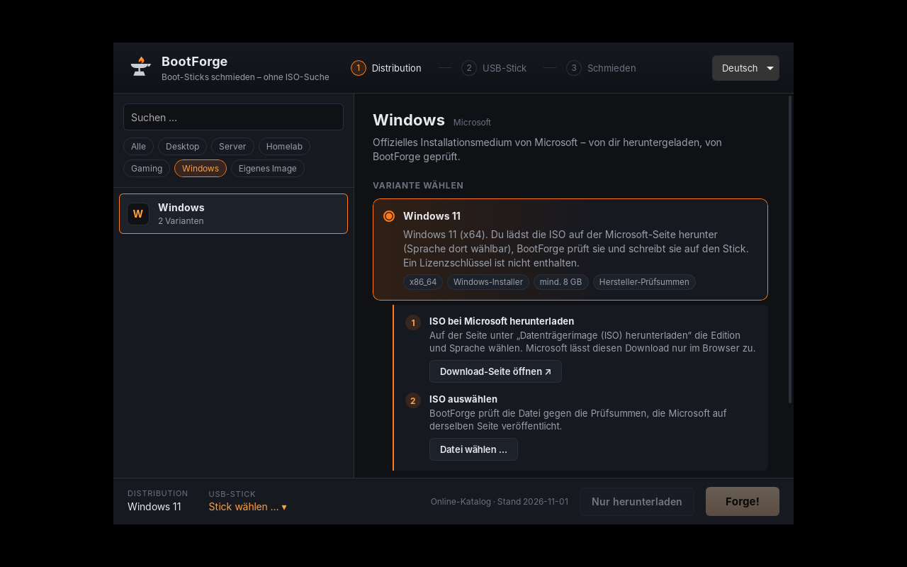
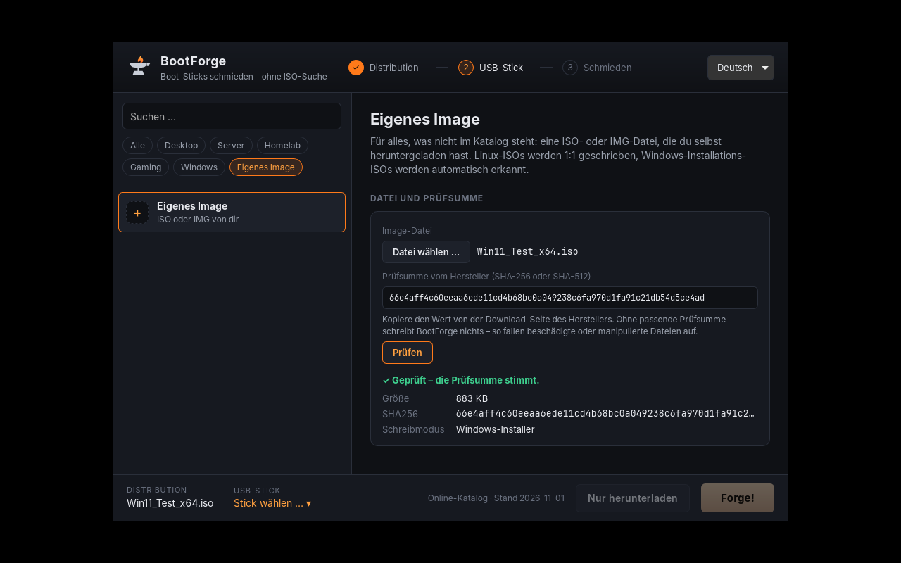
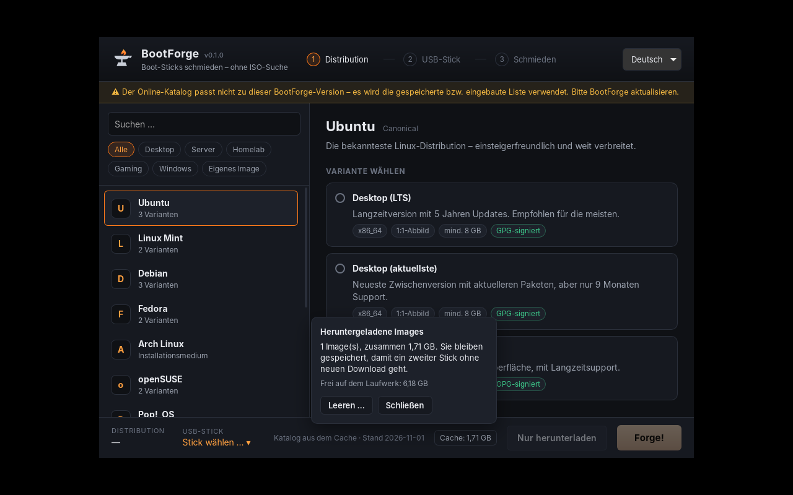

# SealFlash

> Früher **BootForge**. Umbenannt in Version 0.2, weil der Name schon von anderen USB-Boot-Tools
> verwendet wird ([E51](docs/ARCHITEKTUR.md)).

USB-Boot-Sticks erstellen, **ohne selbst ISOs suchen zu müssen**: Distribution wählen, Stick wählen, „Flash!“.
SealFlash lädt die jeweils neueste Version direkt von der offiziellen Quelle, prüft sie (SHA-256 und GPG)
und schreibt sie auf den Stick.

[](https://github.com/xHellPhoenix/sealflash/actions/workflows/ci.yml)

> **Status:** Version 0.2 (alle 7 Phasen umgesetzt). SealFlash ermittelt die neueste Version, lädt sie herunter und prüft
> sie (SHA-256/512 und GPG-Signatur des Herstellers). Dann schreibt es sie auf einen USB-Stick und
> prüft den Stick durch Zurücklesen. **Windows 10/11:** Die ISO lädt man selbst bei Microsoft,
> SealFlash prüft sie gegen Microsofts veröffentlichte Prüfsummen und baut daraus einen
> UEFI-Installationsstick (GPT + FAT32). **Eigenes Image:** beliebige ISO/IMG (auch `.xz`/`.zst`)
> mit der Prüfsumme des Herstellers.

| Version wählen | Herunterladen | USB-Stick wählen | Bestätigen |
|---|---|---|---|
|  |  |  |  |

| Windows 11 | Eigenes Image | Cache |
|---|---|---|
|  |  |  |

## Installieren

Die fertigen Pakete liegen unter [Releases](https://github.com/xHellPhoenix/sealflash/releases).
Jedes Release hat eine `SHA256SUMS.txt` zum Prüfen der Downloads.

| System | Datei | Hinweise |
|---|---|---|
| Windows 10/11 (x64) | `SealFlash_…_x64-setup.exe` (oder `.msi`) | Startet mit Administratorrechten (nötig zum Schreiben auf USB-Laufwerke). wimlib für Windows-ISOs ist enthalten. |
| Debian/Ubuntu (ab 22.04) | `SealFlash_…_amd64.deb` | `sudo apt install ./SealFlash_…_amd64.deb` – installiert auch `wimtools` und pkexec. |
| Fedora/openSUSE | `SealFlash-…x86_64.rpm` | `sudo dnf install ./SealFlash-….rpm` |

Deinstallieren: `sudo apt remove seal-flash` bzw. `sudo dnf remove seal-flash` (Tauri leitet den
Paketnamen aus „SealFlash“ ab). Unter Windows über „Apps & Features“.

Unter Linux läuft SealFlash als normaler Benutzer. Erst beim Schreiben fragt das System nach dem
Administrator-Passwort, für den kleinen Hilfsprozess `/usr/lib/sealflash/sealflash-flash-helper`.
Ein AppImage gibt es bewusst nicht ([E46](docs/ARCHITEKTUR.md)).

Windows warnt beim ersten Start eventuell mit „Der Computer wurde durch Windows geschützt“
(SmartScreen), weil der Installer nicht code-signiert ist. „Weitere Informationen“ → „Trotzdem
ausführen“.

## Aufbau

| Pfad | Inhalt |
|---|---|
| `crates/sealflash-core/` | Die eigentliche Logik in Rust, ohne GUI und testbar |
| `crates/sealflash-flash-helper/` | Linux: kleiner Root-Helper (pkexec), der auf den Stick schreibt |
| `src-tauri/` | Tauri-v2-App: dünne Schicht zwischen GUI und Core |
| `packaging/linux/` | polkit-Regel für den Helper |
| `packaging/windows/` | Skript, das wimlib für den Windows-Installer lädt und prüft |
| `scripts/third_party.py` | Erzeugt [THIRD-PARTY.md](THIRD-PARTY.md) (Lizenzen der Abhängigkeiten) |
| `src/` | GUI (Svelte 5 + TypeScript) |
| `catalog/catalog.json` | Eingebauter Offline-Fallback des Katalogs. Der aktuelle Katalog liegt in [sealflash-catalog](https://github.com/xHellPhoenix/sealflash-catalog) |
| `catalog/catalog.schema.json` | JSON-Schema, **generiert** aus dem Rust-Code |
| `docs/` | [Architektur & Entscheidungen](docs/ARCHITEKTUR.md), [Katalogformat](docs/KATALOG.md), [Release bauen](docs/RELEASE.md), Testanleitungen ([USB](docs/TEST-USB.md), [Schreiben](docs/TEST-FLASH.md), [Windows & eigenes Image](docs/TEST-WINDOWS.md)) |

## Entwickeln

Voraussetzungen: Rust (stable), Node.js ≥ 20, unter Linux zusätzlich
`libwebkit2gtk-4.1-dev libgtk-3-dev librsvg2-dev libssl-dev` ([Tauri-Voraussetzungen](https://v2.tauri.app/start/prerequisites/))
sowie für die GPG-Prüfung `nettle-dev clang` (Debian/Ubuntu-Paketnamen). Unter Windows ist nichts
weiter nötig, dort wird die in Windows eingebaute Kryptografie (CNG) verwendet.

```bash
npm install
npm run tauri dev        # App mit Hot-Reload starten
cargo test --workspace   # Rust-Tests (u. a. Katalog-Validierung)
npm run check            # TypeScript/Svelte prüfen
```

Alle Katalogeinträge gegen die echten Server prüfen (zeigt die aktuell neueste Version jeder Variante):

```bash
cargo run -p sealflash-core --example resolve_all                  # eingebauter Katalog
cargo run -p sealflash-core --example resolve_all ../sealflash-catalog/catalog.json
```

Eine Variante ohne GUI herunterladen und prüfen (Strg+C bricht ab, erneuter Aufruf setzt fort):

```bash
cargo run --release -p sealflash-core --example acquire_one -- debian-netinst /tmp/isos
```

Laufwerke mit Urteil anzeigen (schreibt nichts). Zum Testen mit echten Sticks siehe
[docs/TEST-USB.md](docs/TEST-USB.md):

```bash
cargo run -p sealflash-core --example list_drives
```

Ohne GUI auf einen Stick schreiben (**löscht den Stick!**, Anleitung: [docs/TEST-FLASH.md](docs/TEST-FLASH.md)):

```bash
cargo run --release -p sealflash-core --example forge -- debian-netinst /dev/sdX   # Linux, als root
cargo run --release -p sealflash-core --example forge -- debian-netinst 1           # Windows, Admin-PowerShell
```

Unter Linux schreibt die App über den Helper `sealflash-flash-helper` (über pkexec). Beim Entwickeln
(Debug-Build) muss er neben der App liegen: `cargo build -p sealflash-flash-helper`. Die
Release-Version sucht ihn nur unter `/usr/lib/sealflash/` (siehe [E47](docs/ARCHITEKTUR.md)).

Einen anderen Katalog in der App testen (nur HTTPS):

```bash
SEALFLASH_CATALOG_URL=https://example.org/mein-katalog.json npm run tauri dev
```

Nach Änderungen am Katalog-Datenmodell (`model.rs`) das Schema neu erzeugen:

```bash
cargo run -p sealflash-core --example gen_schema > catalog/catalog.schema.json
```

## Roadmap

1. ✅ Projektstruktur, Tauri-Grundgerüst, Katalog-Schema + Beispielkatalog
2. ✅ Katalog über HTTPS laden (mit Cache) + „neueste Version“ ermitteln
3. ✅ Download + Prüfsumme + GPG
4. ✅ USB-Erkennung (Windows + Linux)
5. ✅ Raw-Flashen + Verifizierung
6. ✅ Windows-ISOs + Windows-Flash-Modus, eigene Images
7. ✅ Installer für Windows und Linux, Release-Workflow, Cache-Verwaltung, Doku

Ideen für danach: Katalog automatisch prüfen (GitHub Action im Katalog-Repo), Code-Signatur für
den Windows-Installer, Auto-Update.
