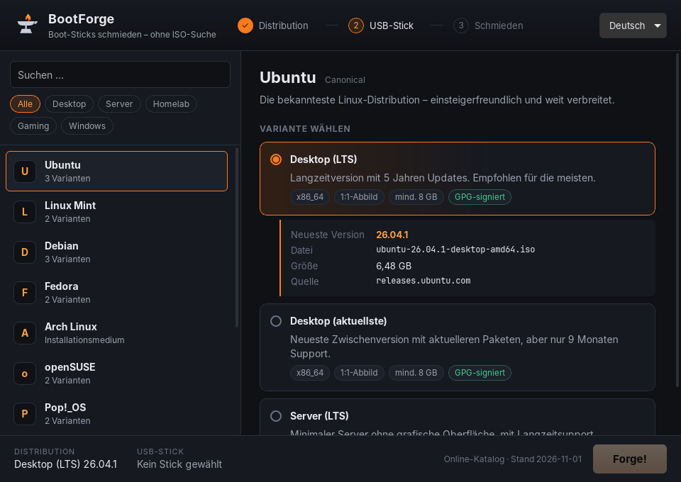
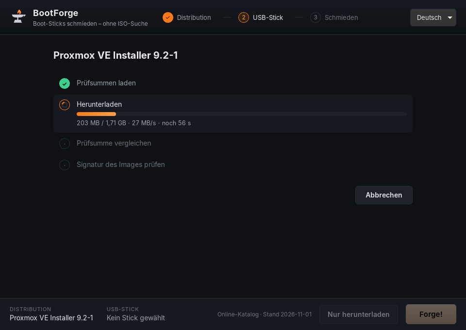
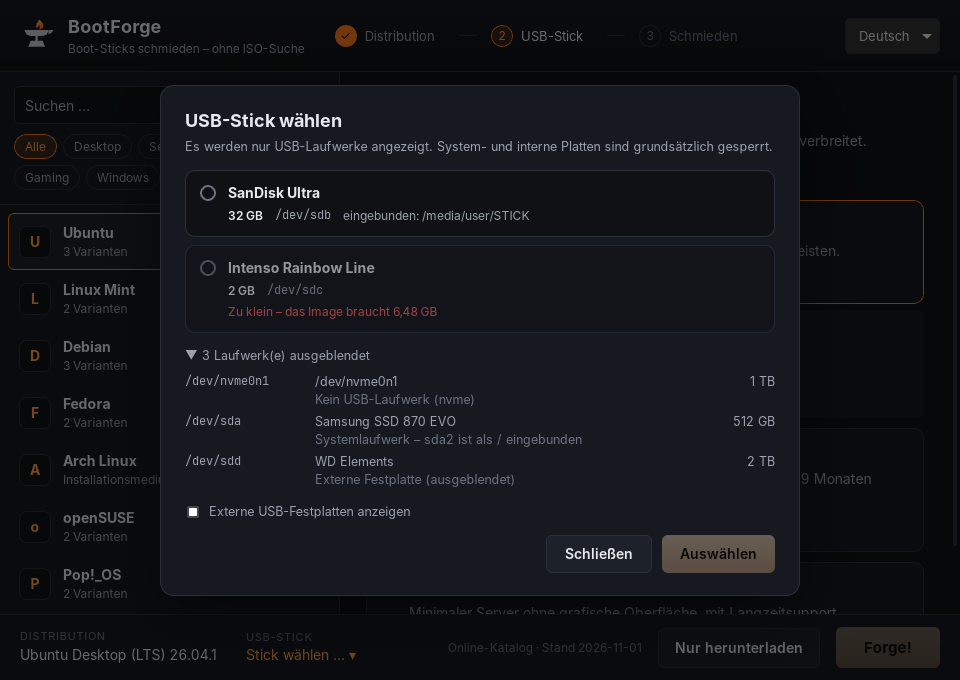
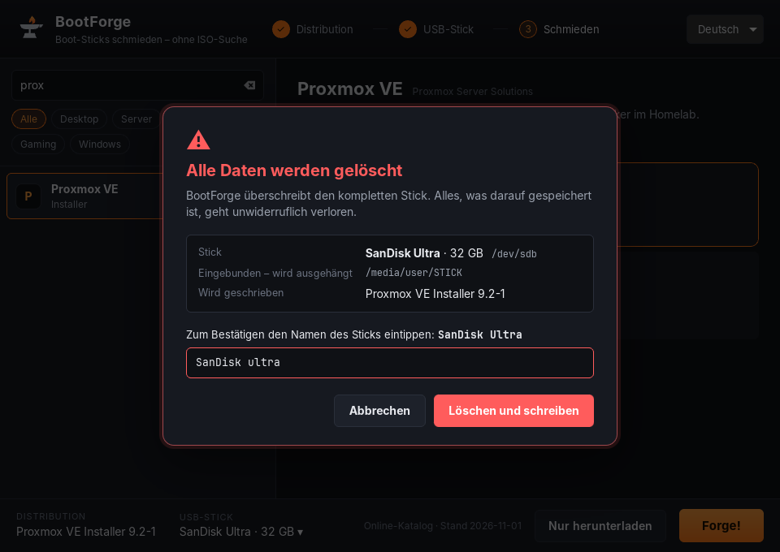

# BootForge

USB-Boot-Sticks erstellen, **ohne selbst ISOs suchen zu müssen**: Distribution wählen, Stick wählen, „Forge!“.
BootForge lädt die jeweils neueste Version direkt von der offiziellen Quelle, prüft sie (SHA-256 und GPG)
und schreibt sie auf den Stick.

[](https://github.com/xHellPhoenix/bootforge/actions/workflows/ci.yml)

> **Status:** Phase 5 von 7. BootForge ermittelt die neueste Version, lädt sie herunter und prüft
> sie (SHA-256/512 und GPG-Signatur des Herstellers). Dann schreibt es sie auf einen USB-Stick und
> prüft den Stick durch Zurücklesen. Es fehlen noch Windows-Installationsmedien (Phase 6) und
> die fertigen Installationspakete (Phase 7).

| Version wählen | Herunterladen | USB-Stick wählen | Bestätigen |
|---|---|---|---|
|  |  |  |  |

## Aufbau

| Pfad | Inhalt |
|---|---|
| `crates/bootforge-core/` | Die eigentliche Logik in Rust, ohne GUI und testbar |
| `crates/bootforge-flash-helper/` | Linux: kleiner Root-Helper (pkexec), der auf den Stick schreibt |
| `src-tauri/` | Tauri-v2-App: dünne Schicht zwischen GUI und Core |
| `packaging/linux/` | polkit-Regel für den Helper |
| `src/` | GUI (Svelte 5 + TypeScript) |
| `catalog/catalog.json` | Eingebauter Offline-Fallback des Katalogs. Der aktuelle Katalog liegt in [bootforge-catalog](https://github.com/xHellPhoenix/bootforge-catalog) |
| `catalog/catalog.schema.json` | JSON-Schema, **generiert** aus dem Rust-Code |
| `docs/` | [Architektur & Entscheidungen](docs/ARCHITEKTUR.md), [Katalogformat](docs/KATALOG.md) |

## Entwickeln

Voraussetzungen: Rust (stable), Node.js ≥ 20, unter Linux zusätzlich
`libwebkit2gtk-4.1-dev libgtk-3-dev librsvg2-dev libssl-dev` ([Tauri-Voraussetzungen](https://v2.tauri.app/start/prerequisites/))
sowie für die GPG-Prüfung `nettle-dev clang` (Debian/Ubuntu-Paketnamen). Unter Windows ist nichts
weiter nötig, dort wird die in Windows eingebaute Kryptografie (CNG) verwendet.

```bash
npm install
npm run tauri dev        # App mit Hot-Reload starten
cargo test --workspace   # Rust-Tests (u. a. Katalog-Validierung)
npm run check            # TypeScript/Svelte prüfen
```

Alle Katalogeinträge gegen die echten Server prüfen (zeigt die aktuell neueste Version jeder Variante):

```bash
cargo run -p bootforge-core --example resolve_all                  # eingebauter Katalog
cargo run -p bootforge-core --example resolve_all ../bootforge-catalog/catalog.json
```

Eine Variante ohne GUI herunterladen und prüfen (Strg+C bricht ab, erneuter Aufruf setzt fort):

```bash
cargo run --release -p bootforge-core --example acquire_one -- debian-netinst /tmp/isos
```

Laufwerke mit Urteil anzeigen (schreibt nichts). Zum Testen mit echten Sticks siehe
[docs/TEST-USB.md](docs/TEST-USB.md):

```bash
cargo run -p bootforge-core --example list_drives
```

Ohne GUI auf einen Stick schreiben (**löscht den Stick!**, Anleitung: [docs/TEST-FLASH.md](docs/TEST-FLASH.md)):

```bash
cargo run --release -p bootforge-core --example forge -- debian-netinst /dev/sdX   # Linux, als root
cargo run --release -p bootforge-core --example forge -- debian-netinst 1           # Windows, Admin-PowerShell
```

Unter Linux schreibt die App über den Helper `bootforge-flash-helper` (über pkexec). Beim Entwickeln
muss er neben der App liegen: `cargo build -p bootforge-flash-helper`.

Einen anderen Katalog in der App testen (nur HTTPS):

```bash
BOOTFORGE_CATALOG_URL=https://example.org/mein-katalog.json npm run tauri dev
```

Nach Änderungen am Katalog-Datenmodell (`model.rs`) das Schema neu erzeugen:

```bash
cargo run -p bootforge-core --example gen_schema > catalog/catalog.schema.json
```

## Roadmap

1. ✅ Projektstruktur, Tauri-Grundgerüst, Katalog-Schema + Beispielkatalog
2. ✅ Katalog über HTTPS laden (mit Cache) + „neueste Version“ ermitteln
3. ✅ Download + Prüfsumme + GPG
4. ✅ USB-Erkennung (Windows + Linux)
5. ✅ Raw-Flashen + Verifizierung
6. Windows-ISOs + Windows-Flash-Modus
7. GUI-Feinschliff, Builds, Doku
