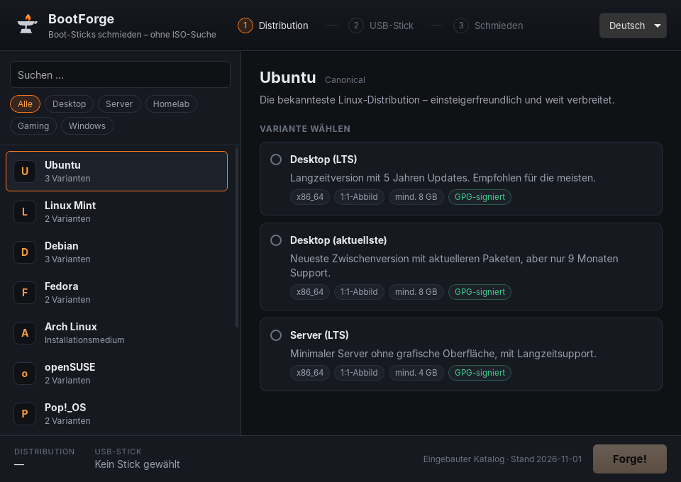

# BootForge

USB-Boot-Sticks erstellen, **ohne selbst ISOs suchen zu müssen**: Distribution wählen, Stick wählen, „Forge!“.
BootForge lädt die jeweils neueste Version direkt von der offiziellen Quelle, prüft sie (SHA-256 und GPG)
und schreibt sie auf den Stick.

> **Status:** Phase 1 von 7 – Grundgerüst und Katalogformat. Download und Flashen gibt es noch nicht.



## Aufbau

| Pfad | Inhalt |
|---|---|
| `crates/bootforge-core/` | Die eigentliche Logik in Rust, ohne GUI und testbar |
| `src-tauri/` | Tauri-v2-App: dünne Schicht zwischen GUI und Core |
| `src/` | GUI (Svelte 5 + TypeScript) |
| `catalog/catalog.json` | Distro-Katalog (wird auch als Offline-Fallback eingebaut) |
| `catalog/catalog.schema.json` | JSON-Schema, **generiert** aus dem Rust-Code |
| `docs/` | [Architektur & Entscheidungen](docs/ARCHITEKTUR.md), [Katalogformat](docs/KATALOG.md) |

## Entwickeln

Voraussetzungen: Rust (stable), Node.js ≥ 20, unter Linux zusätzlich
`libwebkit2gtk-4.1-dev libgtk-3-dev librsvg2-dev libssl-dev` ([Tauri-Voraussetzungen](https://v2.tauri.app/start/prerequisites/)).

```bash
npm install
npm run tauri dev        # App mit Hot-Reload starten
cargo test --workspace   # Rust-Tests (u. a. Katalog-Validierung)
npm run check            # TypeScript/Svelte prüfen
```

Nach Änderungen am Katalog-Datenmodell (`model.rs`) das Schema neu erzeugen:

```bash
cargo run -p bootforge-core --example gen_schema > catalog/catalog.schema.json
```

## Roadmap

1. ✅ Projektstruktur, Tauri-Grundgerüst, Katalog-Schema + Beispielkatalog
2. Katalog über HTTPS laden (mit Cache) + „neueste Version“ ermitteln
3. Download + Prüfsumme + GPG
4. USB-Erkennung (Windows + Linux)
5. Raw-Flashen + Verifizierung
6. Windows-ISOs + Windows-Flash-Modus
7. GUI-Feinschliff, Builds, Doku
